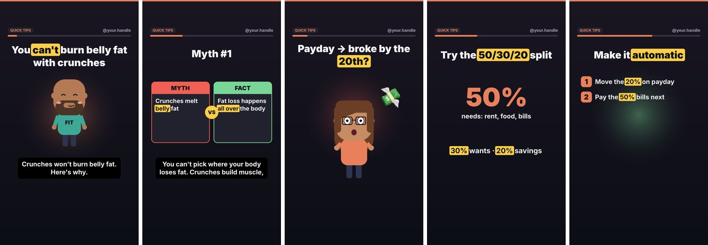
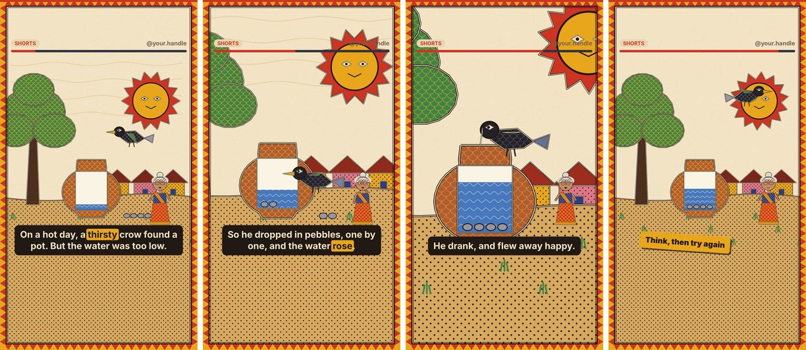
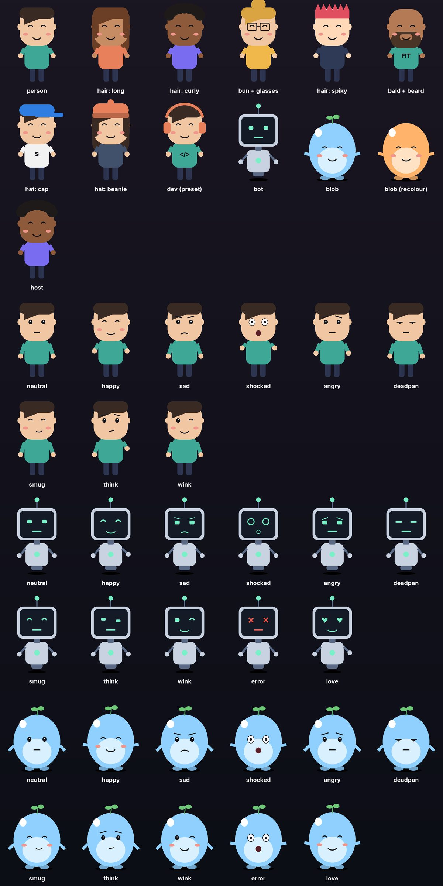
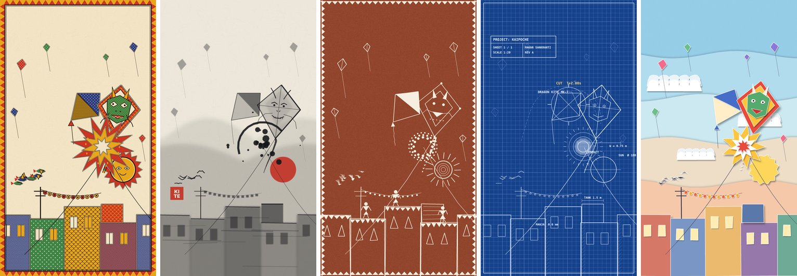
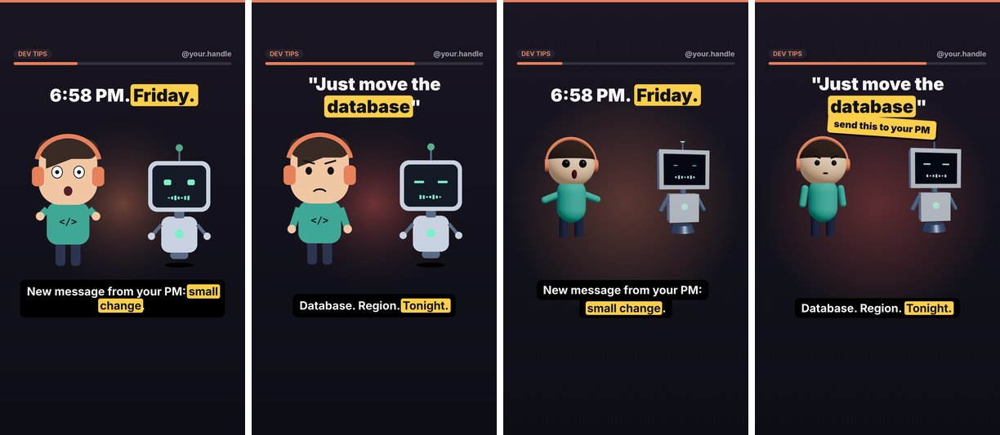

# ctrl-alt-lazy-reel-kit

**Make short vertical videos (Instagram Reels, YouTube Shorts, TikTok) with Claude, for any topic.**
Tell Claude what the video is about. It asks a few questions (topic, audience, script, voice, characters), writes the script if you don't have one, and renders a ready-to-post MP4 plus a cover. No video editor needed, and no stock assets to license: the music, sound effects and characters are all generated from code.



## What you can make

- **Tips and tutorials**: headlines, steps, checklists, a typed terminal for code
- **Narrated explainers**: a voice-over with subtitles over stats, lists, photos and myth-vs-fact cards
- **Character skits and stories**: characters talking with lip sync, from your own voice or an AI voice
- **Top-N lists, before/after, quotes, countdowns**, plus a cover and a preview of your profile grid
- **Style Drops**: one animated scene in several art styles, cut into a "which style wins?" reel

## Draw anything: custom art at runtime

When the built-ins aren't enough (a grandmother storyteller in a sari, a crow and a pot, your product, a village), Claude writes the art for that video as a small file: a custom character that talks and lip-syncs, or a custom picture or scene. It follows the [style guides](docs/style-guides.md) so it matches the chosen art style, and the files stay in your project so the next episode looks the same. How it works: [docs/custom-art.md](docs/custom-art.md). Example: [`folk-story-crow`](examples/folk-story-crow/) (a narrated story, all in Fish-Scale Folk).



## Characters

Pick a built-in character or design your own (hair, skin tone, outfit, hat, glasses, beard, shirt text), then save it in `brand.yaml` so the whole series uses the same cast. Each one has 9–11 moods.



## Art styles and Style Drops

Five original art styles, each inspired by a traditional or familiar art form: **Fish-Scale Folk**, **Rice Paper**, **Mud Wall**, **Cyan Plan** and **Cut Card**. Re-skin any reel with `style: mud-wall`, have Claude draw your story or scene in a style, or put several styles side by side in a Style Drop reel. Every scene comes from your own idea; the example below (a dragon kite cutting a rival kite at Makar Sankranti) is just one of them.



## Skills

| Skill | Use it for |
|---|---|
| [`make-video`](skills/make-video/SKILL.md) | **Start here.** Asks about the topic, audience, script, audio, characters and engine, then builds the video |
| [`reel-planner`](skills/reel-planner/SKILL.md) | Fact check, ranked hooks, timed beat sheet, cover and caption. Nothing renders until you say go ahead |
| [`text-reel`](skills/text-reel/SKILL.md) | Tips, tutorials, narrated explainers, lists, myth vs fact |
| [`dialogue-skit`](skills/dialogue-skit/SKILL.md) | Character skits and stories with voices and lip sync |
| [`style-drop`](skills/style-drop/SKILL.md) | Your scene in many art styles, cut into one reel; also how to add new styles |
| [`reel-cover-grid`](skills/reel-cover-grid/SKILL.md) | Cover image + 3:4 profile-grid preview |

**Install:**
- **Claude Code:** `cp -r skills/* ~/.claude/skills/` (or into `.claude/skills/` inside a project).
- **Claude apps (claude.ai / desktop):** zip a skill folder (e.g. `skills/make-video`) and upload it in Settings, in the Skills section.

Then ask, for example: *"Make a 25-second reel about 3 budgeting mistakes, with a narrator and a cute mascot"*, or *"Make a skit where a chef and a robot argue about pineapple on pizza"*.

## Voice options

| Option | Cost | How |
|---|---|---|
| No voice: music + sound effects | free | default for tips |
| Your own voice | free | `reelkit voices script` prints the lines; record them; `reelkit voices split` cuts the file |
| ElevenLabs | paid credits | `ELEVENLABS_API_KEY` + `reelkit voices tts` |
| OpenAI TTS | paid | `OPENAI_API_KEY` + `reelkit voices tts --provider openai` |
| Built-in voice (macOS `say`, `espeak-ng`) | free, robotic | `reelkit voices tts --provider say` |

## Two engines, same script

| | **Pillow + ffmpeg** (default) | **Remotion + Three.js** (optional) |
|---|---|---|
| Needs | Python 3.9+, ffmpeg | + Node 18+, headless Chrome |
| Characters | flat 2D | 3D (same looks and moods) |
| Art styles + Style Drop | yes | not yet |
| Install | `pip` packages only | + `npm install` (~250 MB) |
| Licence | MIT | Remotion: paid licence for larger companies ([terms](https://www.remotion.dev/license)) |



## Use it without Claude

```bash
git clone --depth 1 https://github.com/ashishjain-dev/ctrl-alt-lazy-reel-kit && cd ctrl-alt-lazy-reel-kit
pip install -e engines/pillow          # use a venv, or add --break-system-packages
reelkit check                          # ffmpeg, fonts, emoji font, available voices

cp brand.example.yaml brand.yaml       # your handle, colours, characters
reelkit characters -o characters.png   # see every character, look and mood
reelkit stills examples/money-tip/scenes.yaml -o stills/f    # quick visual check + contact sheet
reelkit render examples/money-tip/scenes.yaml -o reel.mp4
reelkit cover  examples/money-tip/scenes.yaml -o cover.png
```

A video is one YAML file ([full reference](docs/scenes-reference.md)):

```yaml
brand: brand.yaml
characters:
  coach: {base: person, hair: bald, beard: true, shirt_icon: "FIT"}
scenes:
  - name: hook
    elements:
      - {type: headline, text: "You *can't* burn belly fat with crunches"}
      - {type: character, who: coach, mood: smug, y: 1150, scale: 0.75}
    dialogue:
      - {who: narrator, voice: n1, text: "Crunches won't burn belly fat. Here's why."}
  - name: myth
    elements:
      - type: split
        left: {title: "MYTH", text: "More sweat = more *fat* burned"}
        right: {title: "FACT", text: "Sweat is *cooling*, not burning"}
      - {type: emoji, char: "💦", at: 1.6, y: 1250, size: 160}
```

Examples: [`folk-story-crow`](examples/folk-story-crow/scenes.yaml) (narrated story: a storyteller and full-screen story backgrounds drawn from the script), [`style-drop-kite`](examples/style-drop-kite/scenes.yaml) (one scene file painted in 5 art styles), [`money-tip`](examples/money-tip/scenes.yaml) (stat, list, quote), [`fitness-myths`](examples/fitness-myths/scenes.yaml) (narrator, myth vs fact, custom character), [`dialogue-skit`](examples/dialogue-skit/scenes.yaml) (two characters talking), [`text-reel`](examples/text-reel/scenes.yaml) (tech tip with a terminal).

The Remotion + Three.js engine is documented in [engines/remotion/README.md](engines/remotion/README.md).

## What's in the box

```
skills/            6 Claude skills (SKILL.md each)
engines/pillow/    reelkit: Python engine + CLI (render, stills, audio, cover, grid, characters, voices, timing, check)
engines/remotion/  optional Remotion + Three.js engine (same scenes.yaml, 3D characters)
examples/          folk-story-crow, style-drop-kite, money-tip, fitness-myths, dialogue-skit, text-reel
docs/              scenes.yaml reference, style guides, custom-art guide, preview images
brand.example.yaml
```

Fonts come from your system: Inter and DejaVu by default (both free; any TTF/OTF works), plus a colour emoji font if you use emoji. Use photos and logos you own or have the rights to.

## Credits

Made by [@ctrl.alt.lazy](https://instagram.com/ctrl.alt.lazy). MIT licensed. PRs welcome: new elements, characters, music moods, examples for your niche.
